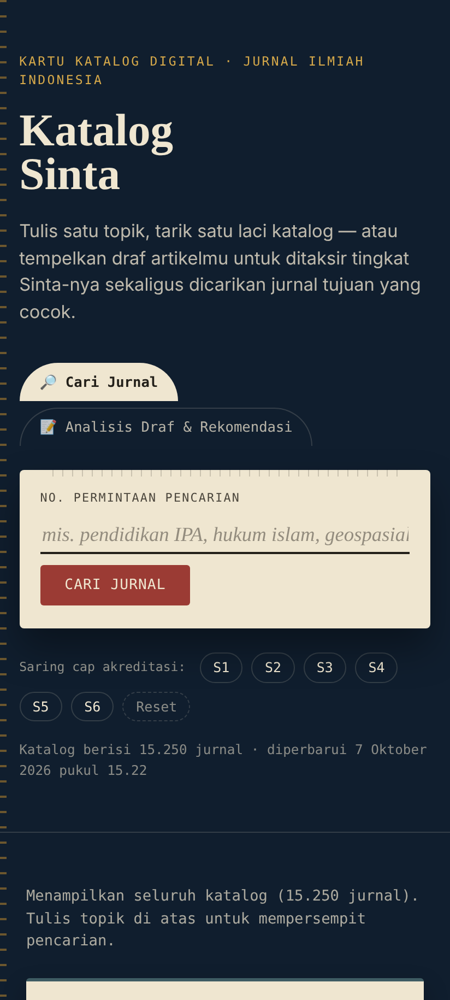
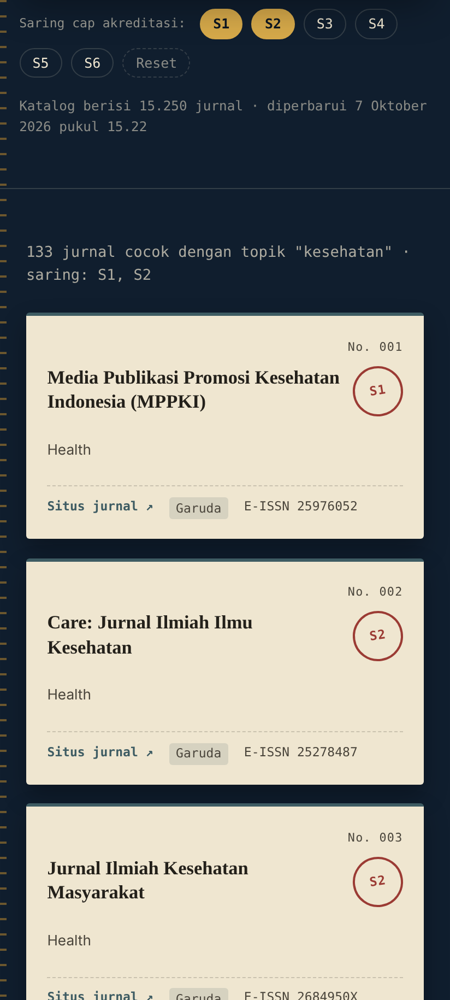
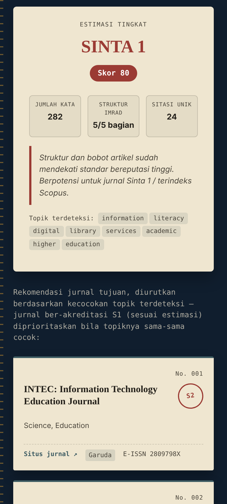

# Sinta Katalog

Documentation for **Sinta Katalog** (`com.sinta.katalog`), an Android app for finding Indonesian academic journals accredited by [SINTA](https://sinta.kemdiktisaintek.go.id) and getting a rough estimate of which SINTA tier a draft article might suit.

The app is written in Indonesian. UI labels are quoted as they appear, with English glosses in parentheses.

<p align="center"><br><sub>Walkthrough: search → filter → draft analysis (browser render, 16 s loop)</sub></p>

<table>
  <tr>
    <td align="center"><br><sub>Search tab</sub></td>
    <td align="center"><br><sub>Topic search + level filter</sub></td>
    <td align="center"><br><sub>Draft analysis</sub></td>
  </tr>
</table>

> **How the screenshots were made.** They are renders of the web app bundled inside the APK, captured in headless Chromium at a 412 × 915 phone viewport (2× pixel density). They are **not** captures from a physical device or Android emulator (the same applies to the animated GIF), so the native status bar, WebView font rendering and Google Fonts are absent. See [`screenshots/README.md`](screenshots/README.md) for the full list and how to regenerate them.

## At a glance

| | |
|---|---|
| App name | Sinta Katalog (header: "Katalog Sinta") |
| Package | `com.sinta.katalog` |
| Version | 1.0 (versionCode 1), **debug build** |
| Android support | 7.0+ (minSdk 24), targets Android 16 (targetSdk 36) |
| Framework | Capacitor (web UI in a WebView), built with Android Gradle Plugin 8.13.0 |
| Permissions | `INTERNET` only |
| Data | 15,250 journals, bundled offline snapshot dated 7 Oct 2026 (07:22 UTC) |
| APK size | 5.2 MB |
| Features | Topic search · S1–S6 level filter · draft analysis & journal recommendation |

## Documentation map

| Doc | What it covers |
|---|---|
| [01 · Overview](docs/01-overview.md) | What the app is for, who it helps, what it deliberately does not do |
| [02 · Installation](docs/02-installation.md) | Sideloading the APK, requirements, uninstalling |
| [03 · User guide](docs/03-user-guide.md) | Screen-by-screen walkthrough with screenshots |
| [04 · How it works](docs/04-how-it-works.md) | Exact search ranking and draft-scoring rules, taken from the source |
| [05 · Data](docs/05-data.md) | `journals.json` schema, statistics, data quirks |
| [06 · Architecture](docs/06-architecture.md) | APK contents, Capacitor layout, network behaviour |
| [07 · Known issues](docs/07-known-issues.md) | Verified bugs and limitations, with suggested fixes |
| [08 · Publishing on GitHub](docs/08-publishing-on-github.md) | Push the repo, share the APK as a Release, keep it updated |

## Repository layout

```
.
├── README.md
├── docs/                    numbered guides (above)
├── screenshots/             15 screenshots + README index + capture log
├── samples/                 two synthetic drafts used for the draft-analysis screenshots
├── assets/                  demo.gif (animated walkthrough), launcher icon and splash from the APK
└── scripts/
    ├── capture_screenshots.py   regenerate every screenshot from an APK
    ├── make_demo_gif.py         regenerate assets/demo.gif (needs ffmpeg)
    ├── inspect_manifest.py      read version / SDK / permissions from the binary manifest
    └── data_stats.py            reproduce the statistics quoted in docs/05-data.md
```

## Highlights from the review

Documenting the app turned up a few real defects, all detailed with evidence and suggested fixes in [07 · Known issues](docs/07-known-issues.md):

- **Every journal title link is broken**: all 15,250 `profile_url` values contain the SINTA domain twice.
- **The S6 filter returns nothing**: the dataset has no S6 journals.
- **"Load more" shows when there are zero results.**
- **The draft estimator is very coarse**: a 282-word sample scores "SINTA 1".

## License

No license has been chosen for this documentation. Add one before publishing.
