# 03 · User guide

The app has two tabs, shown at the top of the screen: **🔎 Cari Jurnal** (Search journals) and **📝 Analisis Draf & Rekomendasi** (Draft analysis & recommendations).

---

## 1. The search tab

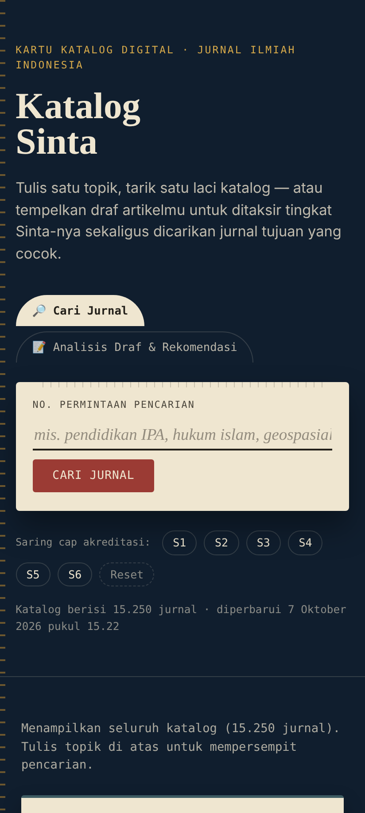

When the app opens you see:

- **Tab switcher**, with "Cari Jurnal" selected.
- **"No. Permintaan Pencarian"** (search request number): the topic box and the red **CARI JURNAL** button.
- **"Saring cap akreditasi"** (filter by accreditation stamp): chips **S1 … S6** and **Reset**.
- A status line with the catalogue size and snapshot date.

The full catalogue is already listed below. Nothing needs to be typed to browse.

 

### Browsing the whole catalogue

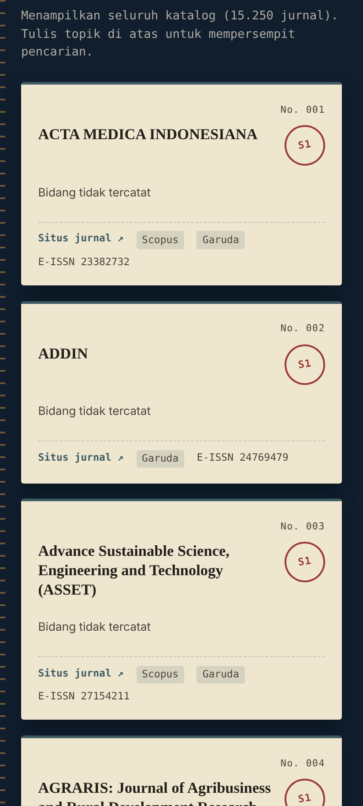

With an empty search box and no filter, the app shows *"Menampilkan seluruh katalog (15.250 jurnal)"* and lists journals **S1 first, then alphabetically** within each level. The numbered tag on each card ("No. 001") is just its position in the current list.

 

### Searching by topic

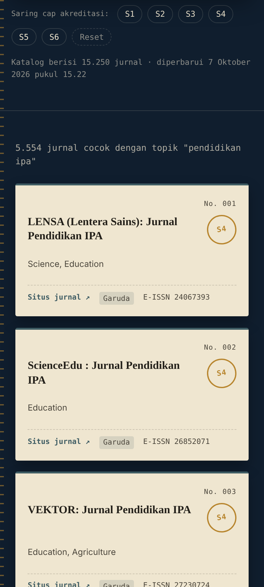

Type a topic, e.g. `pendidikan IPA`. Results update automatically about a quarter of a second after you stop typing. Pressing Enter or tapping **Cari Jurnal** also works.

The status line reports the match count: *"5.554 jurnal cocok dengan topik "pendidikan ipa""*. Best matches come first. Titles that contain your whole phrase and all your words rank highest.

Tips:

- Use the topic words, not method words. Generic academic words (*analisis*, *studi*, *penelitian*, *model*, *sistem*…) are ignored.
- Both Indonesian and English work (*kesehatan* / *health*).
- Several words narrow results toward titles that contain all of them.

 

### Indonesian words that match English subject labels

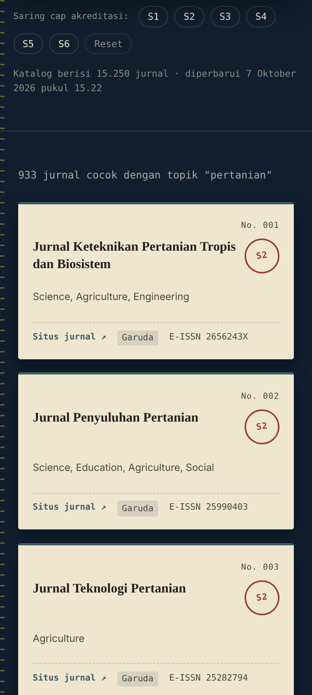

SINTA records each journal's subject area in English (*Agriculture*, *Health*, *Education*…). The app translates 47 common Indonesian words so that, for example, `pertanian` also finds journals labelled *Agriculture* even when "pertanian" is not in the title. The full list is in [04 · How it works](04-how-it-works.md#subject-synonyms).

 

### Filtering by SINTA level

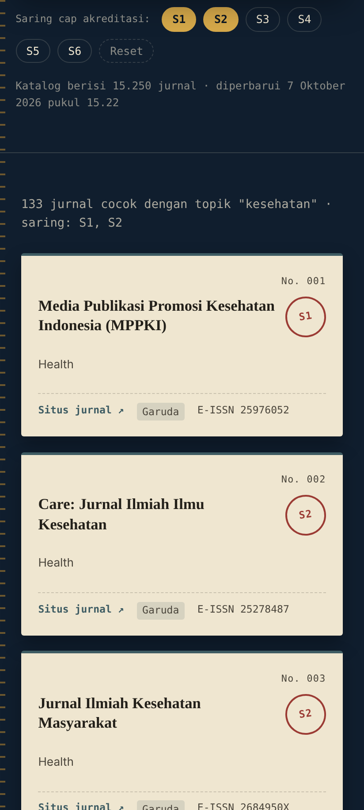

Tap one or more chips to restrict results to those levels. Selected chips turn gold. Chips combine with the topic box: above, `kesehatan` with **S1** and **S2** selected gives *"133 jurnal cocok … · saring: S1, S2"*.

Tap **Reset** to clear all chips (it does not clear the topic box).

> **Note:** the bundled data contains **no S6 journals**, so selecting **S6** alone returns nothing ([known issue](07-known-issues.md#3-the-s6-filter-always-returns-nothing)).

 

### Reading a result card

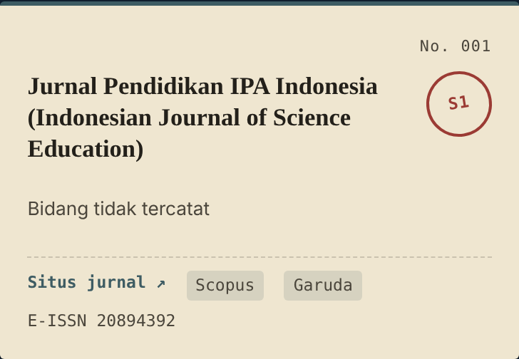

| Element | Meaning |
|---|---|
| **No. 001** | Position in the current results |
| **Title** | Journal name. Tapping it is meant to open the journal's SINTA profile (**currently broken**, see [known issues](07-known-issues.md#1-every-sinta-profile-link-is-broken)) |
| **Round stamp (S1…S5)** | SINTA accreditation level. Colour-coded: S1/S2 red, S3/S4 gold, S5/S6 teal |
| **Subject line** | SINTA subject labels, or *"Bidang tidak tercatat"* (field not recorded) when missing, which is true for 26% of journals |
| **Situs jurnal ↗** | The journal's own website. If none is recorded it reads *"Situs tidak tercatat"* |
| **Scopus / Garuda** | Shown only if the journal is indexed there (216 Scopus, 15,010 Garuda in this snapshot) |
| **E-ISSN** | Electronic ISSN, when recorded |

### When nothing matches

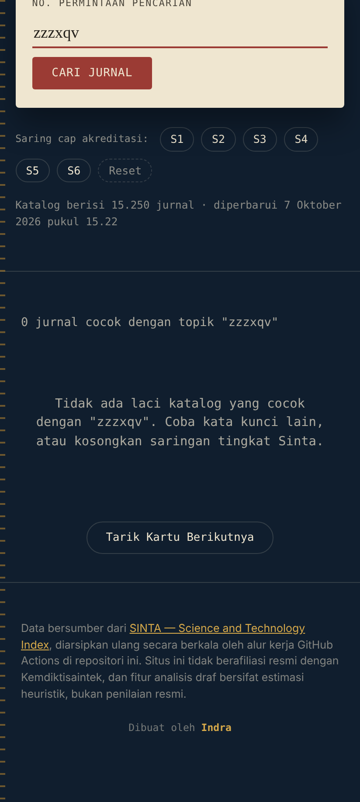

A topic with no matches shows *"Tidak ada laci katalog yang cocok dengan "…". Coba kata kunci lain, atau kosongkan saringan tingkat Sinta."* (No catalogue drawer matches… try other keywords or clear the level filter.) The **Tarik Kartu Berikutnya** button is wrongly still visible here ([known issue](07-known-issues.md#2-load-more-button-stays-visible-with-zero-results)); tapping it just adds another copy of the "no match" message.

 

### Loading more results

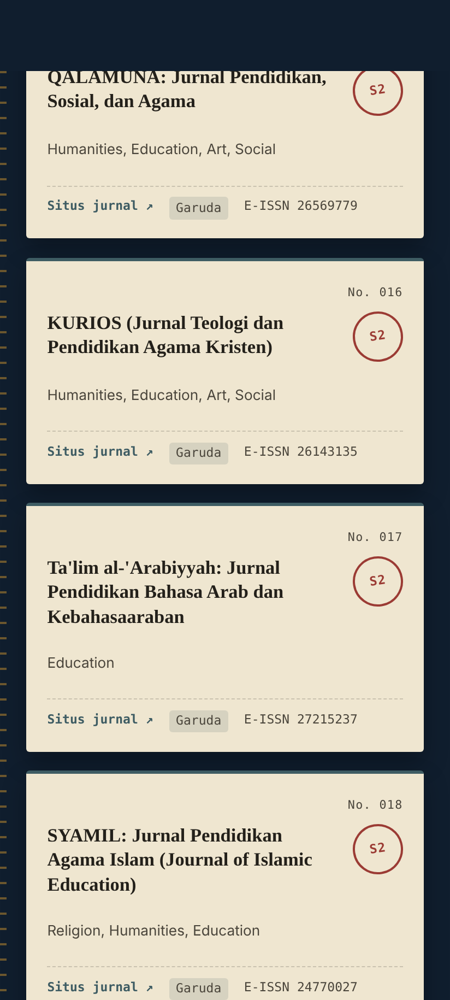

Results appear **18 at a time**. Scroll to the end of the list and tap **Tarik Kartu Berikutnya** ("Pull the next cards") to append the next 18. The button disappears when everything is shown.

 

---

## 2. The draft-analysis tab

Tap **📝 Analisis Draf & Rekomendasi**.

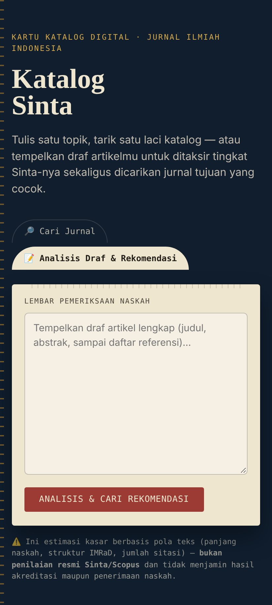

The tab shows **"Lembar Pemeriksaan Naskah"** (manuscript check sheet), a large text box, and the **ANALISIS & CARI REKOMENDASI** button. Below it is a standing disclaimer: this is a rough, pattern-based estimate, **not an official Sinta/Scopus assessment**, and guarantees nothing about accreditation or acceptance.

 

### Step by step

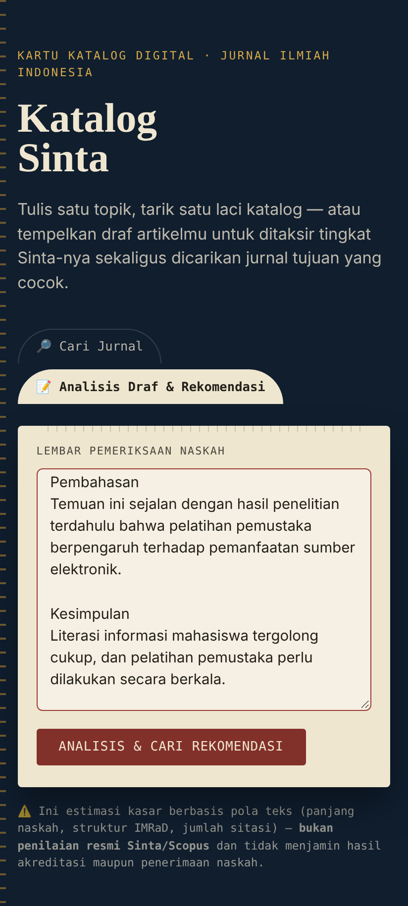

1. **Paste the whole draft**: title, abstract, body and in-text citations. Include a line starting `Kata kunci:` or `Keywords:` if you have one. Those words are used first to find journals.
2. Tap **Analisis & Cari Rekomendasi**.
3. If the text is shorter than 300 characters you get an alert: *"Naskah terlalu pendek untuk dianalisis. Tempelkan draf yang lebih lengkap (minimal beberapa paragraf)."* Paste more and retry.

The samples used in these screenshots are in [`/samples`](../samples).

 

### Reading the report

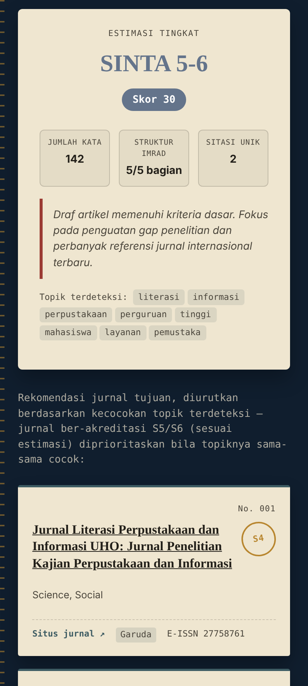

The report card shows:

- **Estimasi Tingkat**: a tier label (*SINTA 1*, *SINTA 2*, *SINTA 3-4* or *SINTA 5-6*) and a numeric **Skor**.
- **Jumlah Kata** (word count), **Struktur IMRaD** (how many of five section types were found, *n*/5) and **Sitasi Unik** (distinct in-text citations).
- A one-sentence piece of advice for that tier.
- **Topik terdeteksi**: up to 8 detected keywords, used to find journals.

Above: a short Indonesian draft scores **30 → SINTA 5-6**.

 

### Reading the recommendations

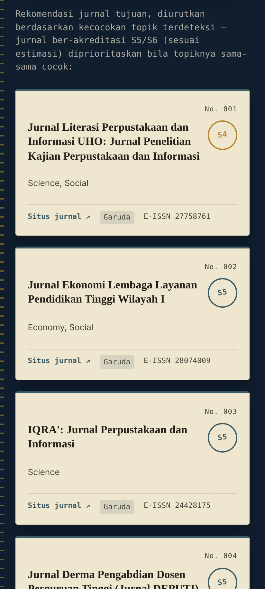

Below the report you get up to **12 recommended journals** as ordinary cards. They are ordered by how well the topic matches. Journals whose level equals the estimated tier get a small boost but are not required, so a topical S4 journal can appear above an S5 one even if the estimate was *SINTA 5-6*.

If no journal matches the keywords at all, the app falls back to the first 12 journals at the estimated level and says so in the status line.

 

### A different draft, a very different result

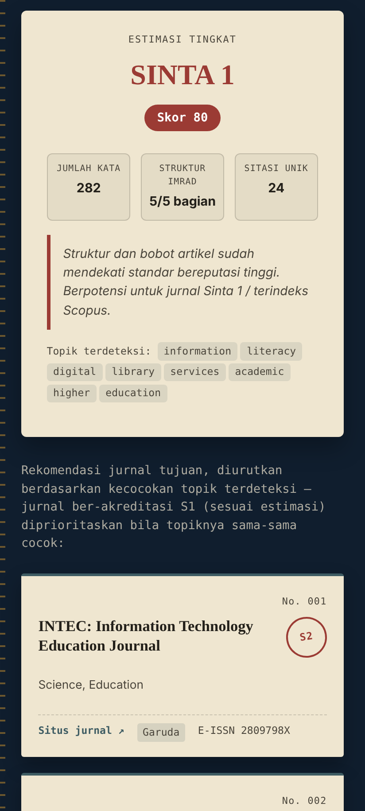

An English-language draft with 24 distinct citations and all five sections scores **80 → SINTA 1**, even though it is only 282 words long. The estimate rewards English text, citation count and section keywords, not scholarly quality. Treat it as a quick structural checklist, never as a prediction. The reasoning is in [04 · How it works](04-how-it-works.md#draft-analysis).

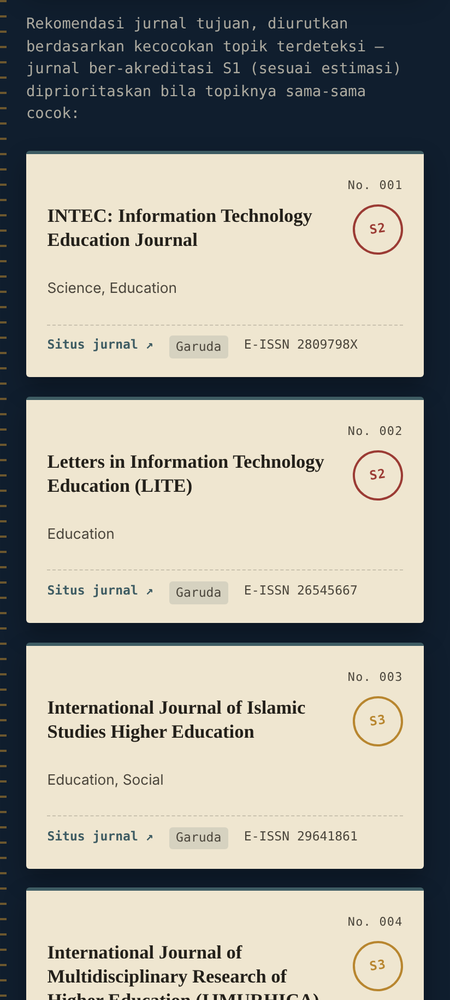

 

---

## 3. Good to know

- **Nothing is saved.** Searches, filters and pasted drafts are lost when the app closes.
- **Works offline.** Search and analysis run entirely on the phone. You only need a connection to open a journal's website, and to load the Google Fonts that the design uses (otherwise default fonts appear).
- **Dates and numbers are Indonesian-formatted** (`15.250`, "7 Oktober 2026").
- **Switching tabs keeps your results.** Each tab keeps its own results while you move between them.
