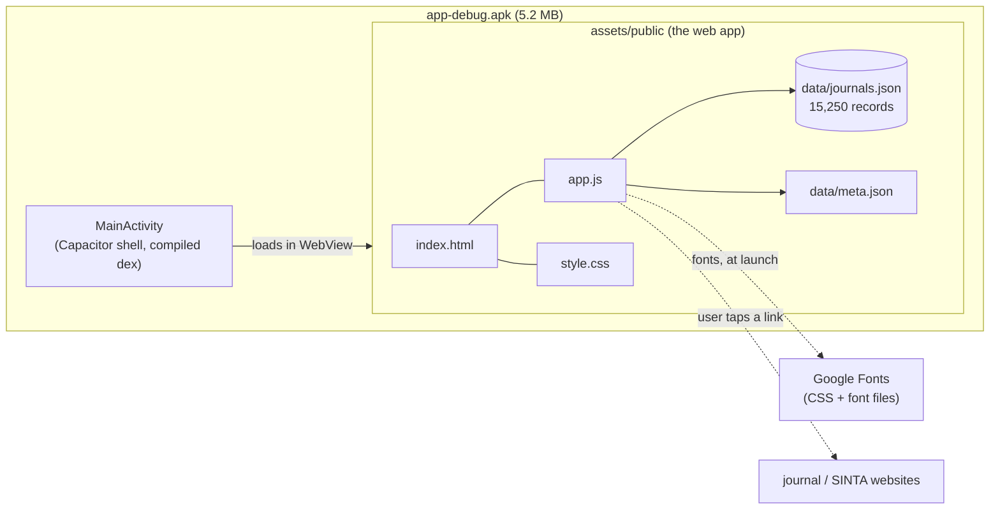

# 06 · Architecture

## In one picture



The app is a **single-page web app wrapped by [Capacitor](https://capacitorjs.com)**. The native layer is a thin shell that hosts a WebView. All logic is in one ~24 KB JavaScript file. There is no UI framework, and the file is readable, unminified source.

## APK contents

| Path | Size | What it is |
|---|---:|---|
| `AndroidManifest.xml` | 6 KB | Package `com.sinta.katalog`, one exported `MainActivity` (launchMode 2 = `singleTask`), `INTERNET` permission, FileProvider, AndroidX startup |
| `classes.dex` … `classes6.dex` | 8.4 MB + 5 smaller | Compiled Capacitor runtime, AndroidX and the shell activity |
| `assets/public/index.html` | 5.3 KB | Markup for both tabs |
| `assets/public/app.js` | 24 KB | All application logic |
| `assets/public/style.css` | 11 KB | Styling, design tokens |
| `assets/public/data/journals.json` | 6.8 MB | The catalogue |
| `assets/public/data/meta.json` | 79 B | Snapshot metadata |
| `assets/native-bridge.js` | 53 KB | Capacitor's JS ↔ native bridge |
| `assets/capacitor.config.json` | 228 B | App id / name / `webDir` |
| `assets/capacitor.plugins.json` | 3 B | `[]`: **no Capacitor plugins installed** |
| `assets/public/cordova.js`, `cordova_plugins.js` | 0 B | Empty compatibility stubs |
| `res/…` | — | Default Capacitor launcher icons and splash, AndroidX resources |
| `META-INF/…/app-metadata.properties` | 57 B | Built with Android Gradle Plugin 8.13.0 |

There are no native `.so` libraries.

### `capacitor.config.json`

```json
{
  "appId": "com.sinta.katalog",
  "appName": "Sinta Katalog",
  "webDir": "www",
  "android": { "compileOptions": { "sourceCompatibility": "JavaVersion.VERSION_17",
                                   "targetCompatibility": "JavaVersion.VERSION_17" } }
}
```

`webDir: "www"` tells you the project layout: the web app lives in a `www/` folder that Capacitor copies into the APK as `assets/public/`.

## Runtime behaviour

**Start-up** (`init()` in `app.js`)

1. Wire up the form, input (220 ms debounce), chips, tabs and buttons.
2. `fetch("data/journals.json")` and `fetch("data/meta.json")` in parallel.
3. Store all 15,250 records in memory, write the "Katalog berisi … jurnal" line.
4. Run an empty search, which renders the first 18 cards (S1 first).

**State** is a single in-memory object (`all`, `filtered`, `activeLevels`, `shown`, `query`). There is no `localStorage`, `IndexedDB` or native storage, so nothing persists.

**Search** is a linear scan of the full array on the main thread with one regular expression per query word per journal, re-run on every debounced keystroke ([algorithm](04-how-it-works.md)). It was not benchmarked on a physical device.

**Rendering** builds card DOM from template strings and appends 18 at a time. Titles and subjects are HTML-escaped. URLs are not ([known issue 12](07-known-issues.md#12-urls-are-not-escaped-when-rendered)).

## Network behaviour

| What | Where | When |
|---|---|---|
| App data (`journals.json`, `meta.json`) | bundled in the APK | start-up, local |
| Google Fonts stylesheet + font files (Source Serif 4, Inter, IBM Plex Mono) | `fonts.googleapis.com`, `fonts.gstatic.com` | every launch while online. If offline, system fonts are used |
| Journal website / SINTA profile / SINTA home | external sites | only when the user taps a link (`target="_blank"`) |

`app.js` contains exactly two `fetch` calls, both for the bundled data files. There is no analytics, tracking, login or backend. Behaviour of external links inside the Capacitor WebView (new tab vs external browser) was not verified on a device.

## Design tokens (from `style.css`)

| Token | Value | Use |
|---|---|---|
| `--navy` / `--navy-deep` | `#101E2E` / `#0B1622` | page background |
| `--parchment` | `#EFE6D0` | cards, search slip |
| `--ink` | `#23201A` | text on parchment |
| `--gold` | `#B8862F` | S3/S4 stamp, selected chips |
| `--stamp-red` | `#9B3B34` | S1/S2 stamp, buttons |
| `--teal` | `#3E5C63` | S5/S6 stamp, card top border |
| Fonts | Source Serif 4 · Inter · IBM Plex Mono | display · body · labels |

The visual theme is a library card catalogue: a gold dashed "drawer rail" runs down the left edge of the screen.

## Building a release

> The project source was not available, so this is the standard Capacitor workflow, not steps verified against this repo.

1. Replace the default icon and splash (e.g. with `@capacitor/assets`).
2. Bump `versionCode` / `versionName` in `android/app/build.gradle`.
3. `npx cap sync android`
4. In Android Studio: **Build → Generate Signed Bundle / APK**, or run `./gradlew assembleRelease` (APK) / `./gradlew bundleRelease` (AAB for Google Play) with your own keystore.

## Updating the data

1. Replace `www/data/journals.json` and `www/data/meta.json`.
2. `npx cap sync android`, then rebuild as above.
3. Check that `meta.json`'s `total_journals` equals the array length.
